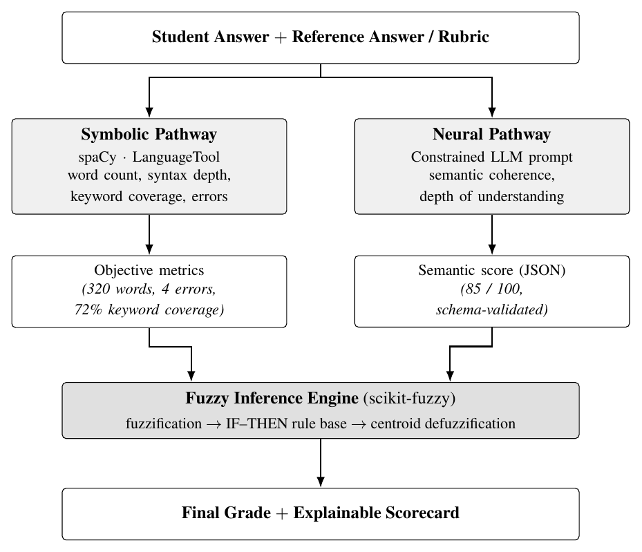

% Neuro-Symbolic Automated Essay/Answer Grading
% with Rule-Based Justification
% Sahil Barnwal (24BDS0256) — extending Agrawal et al., ESWA 239 (2024)

## The Problem

- Hand grading long answers is slow and inconsistent.
- The parent paper (Agrawal et al., 2024) grades well but fuses its
  three NLP modules with a **black-box DNN**.
- The mark has no trace back to the evidence.
- When a student contests a grade, there is nothing auditable to show.
- A mark we cannot defend is not usable.

## The Idea

- Keep the parent paper's three modules as the **evidence**.
- Replace the opaque DNN with a **fuzzy IF-THEN rule base**.
- The rule base *is* the justification — the rules that fired *are* the explanation.
- Neural part = offline sentence embeddings (a sensor, not the judge).
- Output: a grade **plus** the rules and evidence behind it.

## Extends the Parent Paper, Point for Point

| Parent paper (ESWA 2024) | This project |
|--------------------------|--------------|
| Keyword: YAKE + KeyBERT + WordNet | Reused (symbolic) |
| Similarity: SBERT / SimCSE | Reused (neural, offline) |
| NER: spaCy / CamemBERT | Reused (symbolic) |
| Fuse 3 scores with 4-layer DNN | **Fuzzy rule base** |
| Output: one number | Output: number + scorecard |
| Evaluation: RMSE only | + QWK, Pearson, stability |

## System Architecture

{height=3.6in}

## Step 1 - Data

- Public **Mohler (2011) UNT CS short-answer** corpus.
- 2,273 student answers, 79 questions, reference answer each.
- Human grades 0-5 (two annotators), rescaled to 0-100.
- Matches the parent paper's computer-science domain.

## Step 2 - Symbolic Pathway (reused modules)

- **Keyword:** YAKE + KeyBERT on the reference, WordNet synonym
  expansion, coverage of reference keywords.
- **NER:** spaCy entities + numbers/big-O, Jaccard overlap.
- **Mechanics:** length adequacy, grammar errors, syntactic depth
  (advisory penalty only — the axis the parent paper lacked).
- Every metric normalised to 0-100, fully reproducible.

## Step 3 - Neural Pathway (offline)

- **Cross-encoder** (`stsb-roberta-base`) scores the answer–reference
  pair directly — far better pairwise similarity than a bi-encoder.
- Blended with Sentence-BERT per-sentence coverage (0.75 threshold).
- Runs locally — no API, one deterministic number, nothing to hallucinate.
- The only neural component: a semantic **sensor**, not the judge.

## Step 4 - Fuzzy Engine: Setup

- Inputs: **keyword + similarity** (the two informative signals).
- NER dropped from the decision (near-random here, r=0.07) —
  still shown as evidence. Dropping a weak sensor needs no retraining.
- Output grade: Poor / Average / Good / Very Good / Excellent.
- Triangular / trapezoidal membership functions: Low, Medium, High.

## Step 4 - Fuzzy Engine: Rules

- IF similarity High AND keyword High THEN Excellent.
- IF keyword High AND similarity Low THEN Average.
    - the right terms, no real understanding
- IF similarity High AND keyword Low THEN Good.
    - weak wording, strong ideas
- Mamdani inference, then centroid defuzzification.
- Strict / lenient policy = just a different rule set (no code change).

## Step 5 - Scorecard and UI

- Streamlit page: paste both answers, press Grade.
- Show raw metrics: keyword coverage, cosine, entities, errors.
- Show the semantic score separately.
- **List which rules fired and how strongly.**
- Plot the membership functions and the aggregated output.

## Step 6 - Evaluation

- Compare system marks against human marks on all 2,273 answers.
- Metrics: Quadratic Weighted Kappa, Pearson, RMSE.
- Ablation: each module alone vs linear mean vs full fuzzy.
- Paraphrase test: does the grade stay stable?
- Padding test: does filler text raise the grade?

## Results — The Rule Base Adds the Gain

| System | RMSE | Pearson | QWK |
|--------|------|---------|-----|
| mean-baseline | 21.9 | 0.00 | 0.00 |
| similarity-only (cross-enc.) | 36.3 | 0.55 | 0.25 |
| linear mean (same 2 inputs) | 42.8 | 0.54 | 0.21 |
| **full-fuzzy (lenient)** | 35.3 | 0.55 | **0.32** |
| **+ calibration (shipped)** | **17.7** | **0.59** | **0.46** |

- Fuzzy fusion **beats a linear average of the SAME inputs** (0.32 vs 0.21)
  — the rule base, not the inputs, drives the gain.
- Held-out (isotonic calibration): **QWK 0.48, Pearson 0.61, RMSE 18.0**
  < baseline 21.9.

## Results — Stability (what the DNN was never tested for)

- **Paraphrase:** grade moves only **0.24 pts** on average.
- **Padding:** appending filler changes the grade by **-0.5 pts**.
    - the system does *not* reward verbosity — resists length-gaming.
- Stability follows from the architecture: a centroid over a small
  rule base changes smoothly with its inputs.

## Tech Stack

| Part | Tool |
|------|------|
| Parsing, POS, NER | spaCy |
| Keywords | YAKE + KeyBERT + WordNet |
| Semantic judgement | Cross-encoder + Sentence-BERT (offline) |
| Fuzzy inference | from-scratch Mamdani (NumPy) |
| Calibration | isotonic (scikit-learn) |
| Interface | Streamlit |
| Plots | matplotlib |

## Why This Is Neuro-Symbolic

- Neural: the SBERT transformer handles meaning.
- Symbolic: keyword, NER and mechanics give checkable facts.
- Fuzzy rules make the actual decision.
- The neural model is a **sensor, not the judge**.
- A single weak/wrong input cannot move the mark on its own.

## Why a Fuzzy Engine Instead of the DNN?

- The rule base is **readable and editable** by the examiner.
- It encodes **non-linear policies** a weighted sum cannot
  (e.g. right terms + no understanding → Average).
- Every rule's firing strength is exposed → the explanation **is**
  the computation, not a story about it.
- No training, no black box, no hallucinated justification.

## Deliverables

- Streamlit demo, graded live during the review.
- Documented rule base the examiner can edit (strict / lenient).
- Benchmark: our system vs each module vs linear mean vs human.
- Full project report (17 pp) extending the parent paper, with
  real results and figures.
